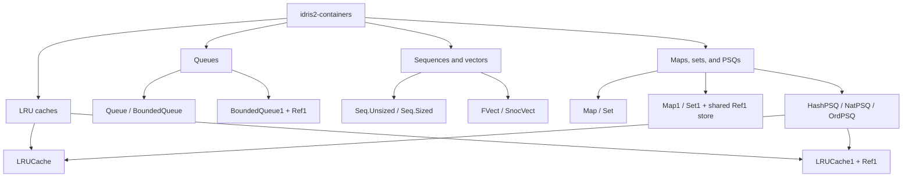
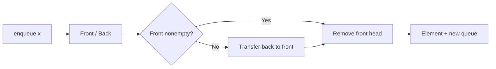
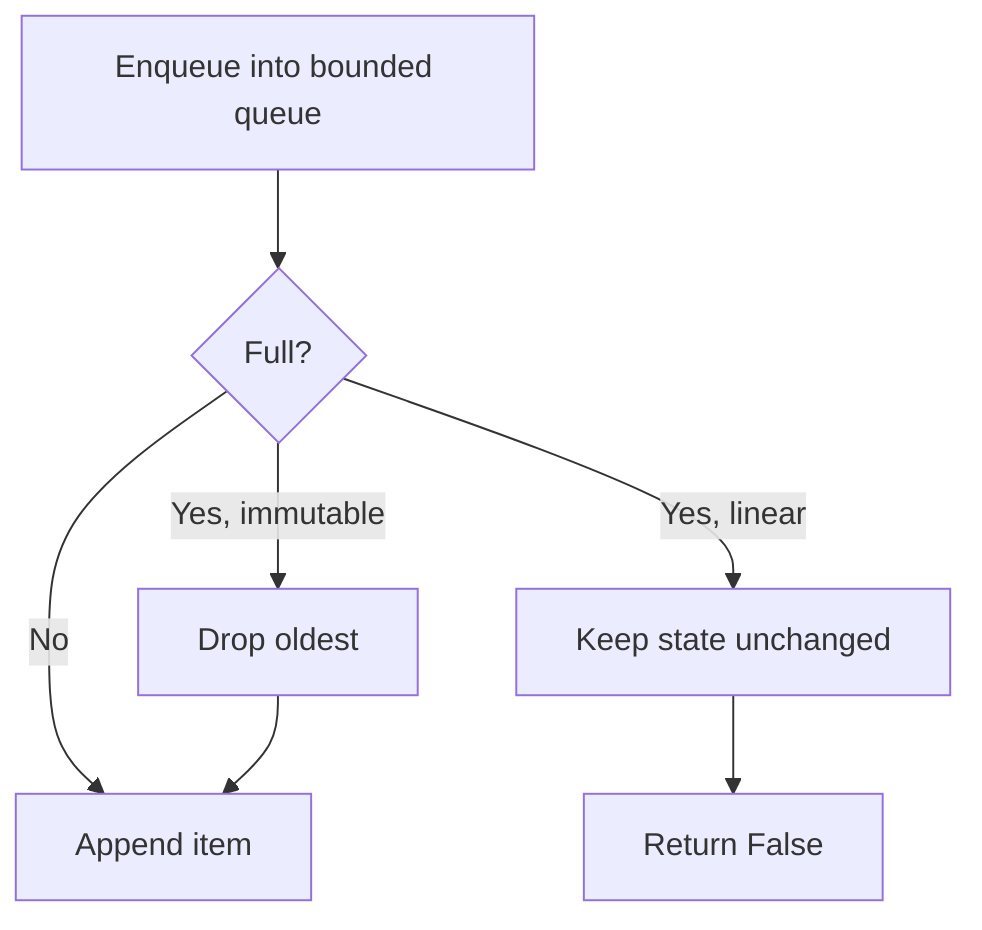
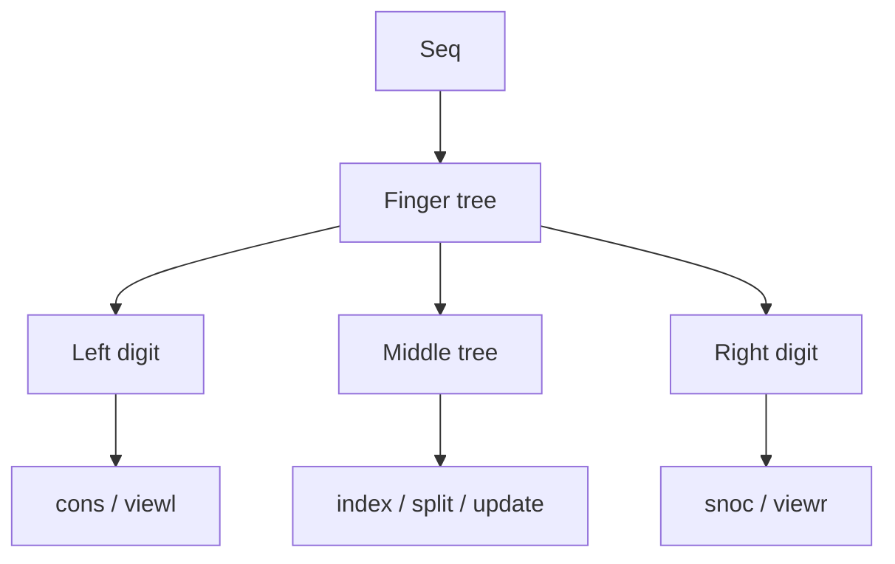
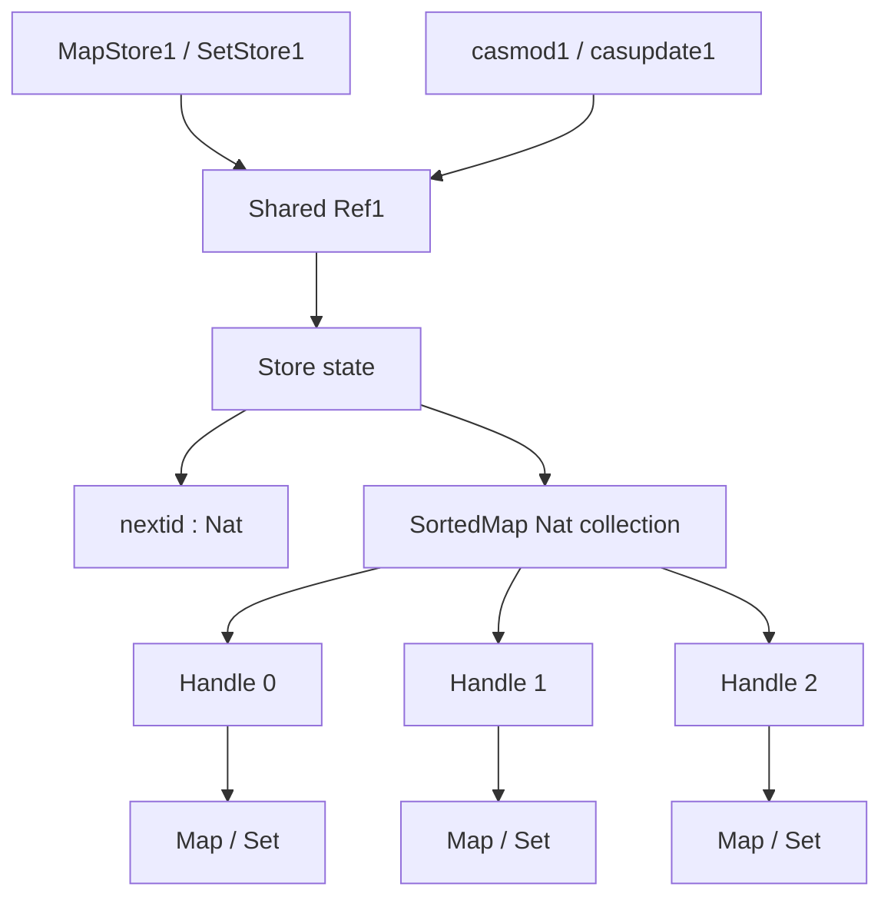
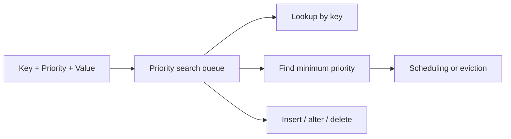
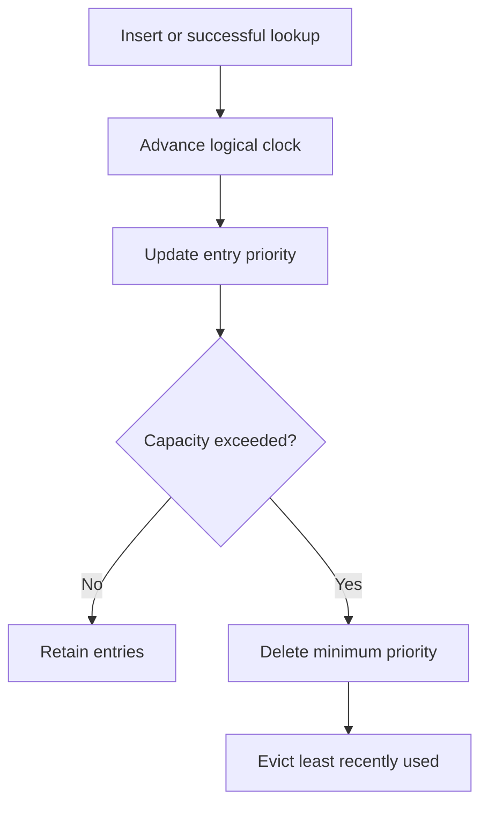

# Assorted concrete container types

A collection of concrete, reusable data structures for Idris2, ranging from
persistent queues and balanced maps to priority search queues, bounded caches,
and length-indexed sequences. The library combines ordinary functional
interfaces with proof-oriented containers and selected mutable, linear APIs.

The goal is to provide practical containers while preserving the distinctions
between ordering, capacity, indexing, and mutation in their public types.

## Installation

The package is named `containers`. It is available through the
[pack-db](https://github.com/stefan-hoeck/idris2-pack-db) package collection
and can also be built from source.

```sh
pack install containers
```

## Features

- Immutable FIFO queues with amortized constant-time enqueue and dequeue.
- Bounded queues with an explicit limit and oldest-element replacement.
- Linear, `Ref1`-backed bounded queues with capacity-aware insertion results.
- Finger-tree sequences supporting operations at both ends and indexed access.
- Sized sequences that track their lengths at the type level.
- Ordered maps and sets with logarithmic tree-based operations.
- Linear maps and sets with CAS-based shared-store updates and snapshots.
- Priority search queues keyed by hashes, natural numbers, or ordered keys.
- LRU caches built on priority search queues, with eviction-aware insertion.
- Linear, `Ref1`-backed LRU caches using CAS-based updates.
- Finite-capacity vectors and length-indexed, snoc-oriented vectors.

## Design considerations

### Persistent vs. mutable interfaces

Most containers return new immutable values, as keeping old versions is valid.
`BoundedQueue1`, `LRUCache1`, `Map1`, and `Set1` instead use a linear state-token
API around mutable references. `Map1` and `Set1` group related containers in a
shared store to make multi-container operations atomic. Use the associated
`ref1` abstraction as intended.

### Runtime and type-level bounds

A runtime maximum in an unsized bounded queue differs from a proof-carrying
capacity bound in `FVect`. Similarly, `Seq.Sized` tracks exact length but a
`Seq.Unsized` returns `Maybe` for out-of-bounds index access. These types
express different guarantees, and they are not interchangeable.

### Costs and tradeoffs

A persistent value is often convenient for reasoning, rollback, and sharing,
but intermediate versions can increase allocation pressure. A mutable cache or
queue can reduce copying of top-level state, but its correctness depends on
proper linear token use and on handling full or missing cases explicitly.
In `Map1` and `Set1`, updates to distinct containers sharing a store contend
on the same CAS reference. Operations across stores are not transactional.

Algorithmic bounds describe the individual implementations, they are not
benchmark results. Measure the workload that matters for your application.

## Model

The library is organized into several related container families rather than
one universal abstraction. Each family exposes operations and invariants suited
to its use case.



The immutable structures return updated values, retaining the original values
for callers that still hold them. The `*1` variants use the linear state-token
interface from `idris2-ref1` to perform safe, mutable operations.

## Container families

| Family          | Public module(s)                     | Primary purpose                      |
| --------------- | ------------------------------------ | ------------------------------------ |
| FIFO queue      | `Data.Queue`                         | Persistent first-in, first-out queue |
| Bounded queue   | `Data.BoundedQueue.Unsized`          | Queue with fixed capacity            |
| Linear queue    | `Data.BoundedQueue1.Unsized`         | Ref-backed bounded queue             |
| Sequences       | `Data.Seq.Unsized`, `Data.Seq.Sized` | Two-ended sequences                  |
| Maps and sets   | `Data.Map`, `Data.Set`               | Ordered key-value collections        |
| Linear map      | `Data.Map1`                         | Atomic shared-store maps             |
| Linear set      | `Data.Set1`                         | Atomic shared-store sets             |
| Priority queues | `Data.HashPSQ`, `Data.NatPSQ`        | Keyed priority search                |
| Ordered PSQ     | `Data.OrdPSQ`                        | Ordered-key priority search          |
| LRU cache       | `Data.LRUCache`                      | Immutable bounded cache              |
| Linear cache    | `Data.LRUCache1`                     | Ref-backed bounded cache             |
| Finite vector   | `Data.FVect`                         | Length and maximum capacity          |
| Capacity view   | `Data.FVect.Capacity`                | Full/not-full evidence               |
| Snoc vector     | `Data.SnocVect`                      | Length-indexed right extension       |

`*.Internal` modules provide representations or supporting algorithms for
these public modules. They are listed in the package but are not the preferred
entry points for most application code.

## Immutable FIFO queue

`Data.Queue` implements a persistent FIFO queue using a front list and a back
snoc-list. New items are appended to the back, as dequeue normally reads from the
front. When the front is empty, the back is transferred to the front.



Although a transfer can cost O(n), each element crosses between the two sides
at most once before removal. Enqueue and dequeue therefore have amortized
O(1) costs.

### Example

```idris
import Data.Queue

queueExample : Maybe (Int, Queue Int)
queueExample =
  let q0 = Data.Queue.empty
      q1 = Data.Queue.enqueue q0 10
      q2 = Data.Queue.enqueue q1 20
   in Data.Queue.dequeue q2
```

`dequeue` returns `Nothing` for an empty queue and otherwise returns the oldest
element together with the remainder. `peekOldest` also returns a queue, as reuse
that returned the queue to preserves the amortized complexity guarantee.

### API overview

| Operation    | Type / result                   | Complexity     |
| ------------ | ------------------------------- | -------------- |
| `empty`      | `Queue a`                       | O(1)           |
| `fromList`   | `List a -> Queue a`             | O(1)           |
| `enqueue`    | `Queue a -> a -> Queue a`       | O(1)           |
| `dequeue`    | `Queue a -> Maybe (a, Queue a)` | Amortized O(1) |
| `prepend`    | `a -> Queue a -> Queue a`       | O(1)           |
| `peekOldest` | `Queue a -> Maybe (a, Queue a)` | Amortized O(1) |
| `length`     | `Queue a -> Nat`                | O(n)           |

## Bounded queues

The two bounded queue implementations have different full-capacity semantics.
This difference matters when choosing a queue for buffering or concurrent work.

| Operation at capacity | Immutable                  | Linear (`*1`)       |
| --------------------- | -------------------------- | ------------------- |
| `enqueue`             | Replaces oldest item       | Returns `False`     |
| `prepend`             | Replaces oldest item       | Returns `False`     |
| `dequeue`             | Returns item and new queue | Returns `Maybe a`   |

`Data.BoundedQueue.Unsized` retains at most the configured number of elements.
When full, its `enqueue` removes the oldest item before appending the new one.
This makes it useful for rolling buffers and fixed-size histories.

By contrast, `Data.BoundedQueue1.Unsized.enqueue` returns `F1 s Bool`, where
`False` indicates that the item was not accepted because the queue was full.
This makes it suitable for admission-controlled work queues. The linear version
stores queue state in a `Ref1` and updates it through `casupdate1`.



The configured limit is a runtime `Nat`. The `Unsized` modules do not carry
the limit in their type. A limit of zero deserves special care, since no item
can be retained.

## Finger-tree sequences

`Data.Seq.Unsized` and `Data.Seq.Sized` are general-purpose two-ended
sequences backed by finger trees. They provide efficient construction at both
ends and logarithmic indexed operations near the middle of a sequence.



### Unsized vs. sized sequences

| Property     | `Seq.Unsized`           | `Seq.Sized`                 |
| ------------ | ----------------------- | --------------------------- |
| Main type    | `Seq a`                 | `Seq n a`                   |
| Empty value  | `Seq a`                 | `Seq 0 a`                   |
| Add one item | Returns `Seq a`         | Returns `Seq (S n) a`       |
| Left view    | `Maybe (a, Seq a)`      | `(a, Seq n a)` for nonempty |
| Indexing     | `Nat -> ... -> Maybe a` | Proof-checked or `Fin n`    |
| Split        | Runtime position        | Index reflected in types    |

For example, the unsized interface exposes:

```idris
import Data.Seq.Unsized

sequenceExample : Maybe Int
sequenceExample =
  let xs = Data.Seq.Unsized.fromList [10, 20, 30]
   in Data.Seq.Unsized.index 1 xs
```

The sized version encodes the length as `Seq n a`. Its `index` operation
accepts evidence that the index is in range, while `index'` accepts `Fin n`.
This moves an indexing precondition into type checking rather than returning
`Nothing` at runtime.

### Key operations

| Operation         | Unsized complexity  | Sized behavior              |
| ----------------- | ------------------- | --------------------------- |
| `cons`, `snoc`    | O(1)                | Updates length index        |
| `viewl`, `viewr`  | O(1)                | Requires nonempty input     |
| `(++)`            | O(log(min(m, n)))   | Result length `m + n`       |
| `index`, `update` | O(log(min(i, n-i))) | Index checked by type       |
| `splitAt`         | O(log(min(i, n-i))) | Split lengths tracked       |
| `length`          | O(1)                | Length available from index |

The stated bounds follow the respective module documentation. The code and
runtime costs of proof elaboration, conversions, and other helpers can differ.

## Finite-capacity and snoc vectors

`Data.FVect` encodes both maximum capacity and current length:

```idris
FVect : (capacity : Nat)
     -> (len : Fin (S capacity))
     -> (elem : Type)
     -> Type
```

Unlike a conventional `Vect n a`, an `FVect` can be filtered or shortened while
retaining its original capacity bound. `Data.FVect.Capacity` exposes the
`Full` and `NotFull` cases, together with evidence needed for capacity-aware
operations.

`Data.SnocVect` is a backwards-oriented, length-indexed vector. Instead of
constructing from the left with `(::)`, it grows from the right with `(:<)`.
This representation is convenient for algorithms that naturally append values.

```idris
import Data.SnocVect

suffix : SnocVect 3 Int
suffix = [<] :< 1 :< 2 :< 3
```

## Ordered maps and sets

`Data.Map` and `Data.Set` expose persistent ordered collections with tree
representations. The modules include insertion, deletion, membership tests,
folds, and other operations for manipulating finite collections.

The implementations maintain balanced search trees, so normal key-based
operations are logarithmic in collection size. Because their APIs use names
also found in Prelude or other libraries, qualify operations at call sites
when imports introduce ambiguity.

These modules are distinct from the Idris2 `base` map and set modules. Imports
should be checked carefully when combining the libraries.

### Linear maps and sets

`Data.Map1` and `Data.Set1` provide mutable counterparts to the persistent
ordered collections. Each exposes a shared store holding multiple maps or sets,
with an individual handle identifying one collection within that store.

`MapStore1 s region k v` holds maps with the same key and value types,
while `SetStore1 s region a` holds sets with the same element type. The
`region` parameter associates handles with a store scope. Each opaque
store holds one `Ref1`-managed state containing a `SortedMap` from `Nat` identifiers to
persistent values and a monotonic `nextId` counter. Store and handle
constructors are hidden, so callers cannot forge identifiers or directly
modify the underlying state. Allocation atomically inserts a collection and
increments `nextId`, without reusing identifiers if entries are removed.



Single-container mutations such as `insert` and `delete` return `F1 s Bool`,
where `True` indicates that the operation successfully completed,
and `False` indicates an invalid container handle. Queries such as `member`,
`lookup`, and `freeze` return their results in `F1 s`. A frozen snapshot is an
immutable `Map` or `Set` that is unaffected by later changes to its source.

Operations involving two handles, such as `union`, `difference`, and
`intersection`, read both collections inside one shared-store CAS callback.
`Map1.swap` exchanges two maps atomically, `Set1.transfer` moves an element
between two sets in the same store. Queries across two collections likewise
read one store snapshot, so they do not observe partially committed changes.

**Both handles must belong to the same store.** Binary operations require
matching `region` parameters, and `withStore` or `withStoreIO` scopes store
creation. This restricts accidental cross-scope use, but the current rank-2
callback implementation has not been established as genuinely generative:
matching region types alone do not prove runtime store identity. A CAS callback
may run more than once under contention and must remain pure.

### Linear map example

```idris
import Data.Map1

mapExample : F1 s (Maybe (Maybe String))
mapExample t =
  Data.Map1.withStore (\store => \t =>
    let m # t := Data.Map1.singleton 1 "one" store t
        _ # t := Data.Map1.insert 2 "two" m t
     in Data.Map1.lookup 2 m t) t
```

### Linear set example

```idris
import Data.Set1

setExample : F1 s (Maybe (List Nat))
setExample t =
  Data.Set1.withStore (\store => \t =>
    let a # t := Data.Set1.fromList [1, 2, 3] store t
        b # t := Data.Set1.fromList [3, 4] store t
        _ # t := Data.Set1.union a b t
     in Data.Set1.toList a t) t
```

The map example returns `Just (Just "two")`, and the set example returns
`Just [1, 2, 3, 4]`. The set union is a single atomic update because both
handles were allocated from the same store.

### Linear API overview

| Operation     | Result                                         | Notes               |
| ------------- | ---------------------------------------------- | ------------------- |
| `withStore`   | `(forall region . Store -> F1 s b) -> F1 s b`  | Scoped store        |
| `withStoreIO` | `(forall region . Store -> IO b) -> IO b`      | Concurrent scope    |
| `empty`       | `F1 s (Map1 s region k v)` or similar          | Allocate in store   |
| `fromList`    | `F1 s (Map1 s region k v)` or similar          | Allocate entries    |
| `insert`      | `F1 s Bool`                                    | Atomic modification |
| `delete`      | `F1 s Bool`                                    | Atomic modification |
| `lookup`      | `F1 s (Maybe (Maybe v))` (`Map1`)              | Read snapshot       |
| `member`      | `F1 s (Maybe Bool)` (`Set1`)                   | Read snapshot       |
| `freeze`      | `F1 s (Maybe (Map k v))` or similar            | Immutable snapshot  |
| `union`       | `F1 s Bool`                                    | Same-store CAS      |
| `swap`        | `F1 s Bool` (`Map1`)                           | Atomic swap         |
| `transfer`    | `F1 s (Maybe Bool)` (`Set1`)                   | Atomic transfer     |

Key-based operations retain the underlying balanced-tree behavior, but also
incur a lookup and possible replacement in the store's `SortedMap`. Concurrent
modifications to any collections in the same store may trigger CAS retries.
Mapping to a different value or element type allocates into a destination
store and does not form a transaction across two separate stores.

## Priority search queues

Priority search queues (PSQs) associate keys with both a priority and a value.
They support lookup by key while making minimum-priority entries accessible
for scheduling, eviction, and other ordered-processing tasks.

| Module         | Key discipline        | Typical use                    |
| -------------- | --------------------- | ------------------------------ |
| `Data.HashPSQ` | Hashable ordered keys | Cache and lookup workloads     |
| `Data.NatPSQ`  | Natural-number keys   | Integer-keyed priorities       |
| `Data.OrdPSQ`  | Ordered keys          | General ordered-key priorities |



The priority and key ordering may be used together for deterministic tie
handling. Check the chosen PSQ module's constraints and operation contracts
rather than assuming the three variants have interchangeable representations.

## Least-recently-used caches

`Data.LRUCache` builds a capacity-limited cache around `Data.HashPSQ`. Each
insertion or successful lookup updates a logical recency counter, which is
stored as the entry priority. Once insertion grows the cache beyond its
capacity, the minimum-priority (least recently used) entry is removed.



### Immutable cache API

| Operation    | Result                         | Notes                 |
| ------------ | ------------------------------ | --------------------- |
| `empty`      | `Nat -> LRUCache k v`          | Creates cache         |
| `insert`     | `LRUCache k v`                 | Inserts and trims     |
| `insertView` | `(Maybe (k, v), LRUCache k v)` | Exposes eviction      |
| `lookup`     | `Maybe (v, LRUCache k v)`      | Returns updated cache |

`Data.LRUCache.lookup` is not only a read, as a hit returns a replacement cache
with refreshed recency metadata. Callers should retain that returned value.
The immutable `empty` implementation requires positive capacity, as passing zero
raises an error.

### Linear cache API

`Data.LRUCache1` wraps cache state in `Ref1` and uses CAS updates for insertion,
eviction, and lookup. The core operations return values inside `F1 s`:

| Operation    | Result shape                           |
| ------------ | -------------------------------------- |
| `empty`      | `F1 s (LRUCache1 s k v)`               |
| `insert`     | `F1 s (LRUCache1 s k v)`               |
| `insertView` | `F1 s (Maybe (k, v), LRUCache1 s k v)` |
| `lookup`     | `F1 s (Maybe (v, LRUCache1 s k v))`    |

Unlike the immutable API, these calls thread linear state through `F1 s`.

## Choosing a container

| Requirement                        | Suggested type      |
| ---------------------------------- | ------------------- |
| Simple persistent FIFO             | `Queue a`           |
| Rolling fixed-size history         | `BoundedQueue a`    |
| Admission-controlled queue         | `BoundedQueue1 s a` |
| Efficient operations at either end | `Seq a`             |
| Length-checked indexing            | `Seq n a`           |
| Runtime size bounded in types      | `FVect c l a`       |
| Build a vector from the right      | `SnocVect n a`      |
| Ordered association lookup         | `Map k v`           |
| Ordered membership                 | `Set a`             |
| Shared mutable ordered lookup      | `Map1 s region k v` |
| Shared mutable ordered membership  | `Set1 s region a`   |
| Keyed minimum-priority work        | A PSQ variant       |
| Immutable LRU eviction             | `LRUCache k v`      |
| CAS-backed mutable LRU             | `LRUCache1 s k v`   |
